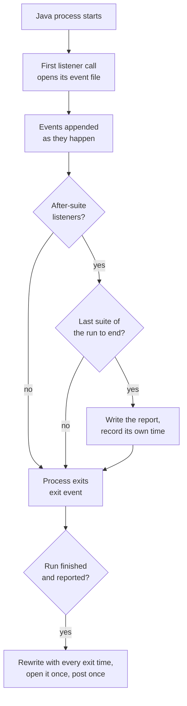
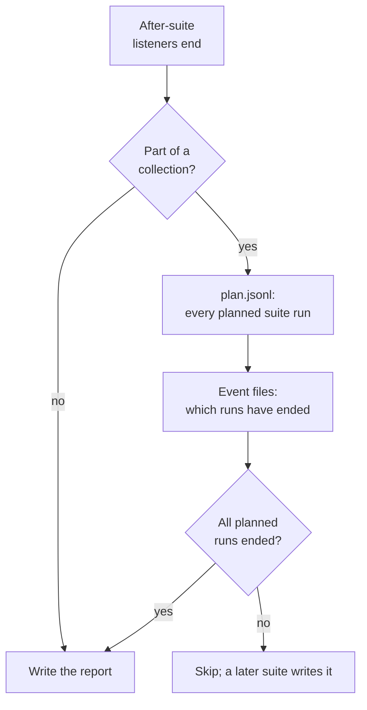

# Architecture

How Run Clock is put together, and why the harder parts work the way they
do. It assumes you have read the README's "Why this exists" table.

## Integration point

Katalon Studio discovers any class under `Test Listeners/` and calls its
methods annotated `@BeforeTestSuite`, `@BeforeTestCase`, `@AfterTestCase`
and `@AfterTestSuite`. That is the whole integration: no plugin, no OSGi
bundle, no build step. `RunClockListener.groovy` has four one-line methods
that hand each call to `RunClockRecorder`. The other files are copied into
folders Katalon already compiles (`Keywords/`, `Include/`), so a project
behaves the same in Katalon Studio, with `katalonc` and on a CI agent.

## Component layout

```
Test Listeners/RunClockListener.groovy        Katalon's entry point; delegation only
Keywords/runclock/RunClockRecorder.groovy     one per Java process: appends events, decides when to write
Keywords/runclock/RunClockReport.groovy       reads every event file, works out times and advice, writes the reports
Keywords/runclock/RunClockSettings.groovy     runclock.properties and RUN_CLOCK_* environment variables
Include/config/runclock/report.html           report and All runs page template
Include/config/runclock/runclock.properties   settings
```

## What a run looks like to Run Clock

With Enable Parallel Execution on, Katalon runs a suite as several Java
processes: one for the before-suite listeners, one per test case, and one
for the after-suite listeners. With it off, a suite is one process. A Test
Suite Collection runs its suites one after another or several at once,
each in the same way.

The processes share no memory, so each one keeps its own event file,
`Reports/<run>/run-clock/<pid>-<jvm start>.jsonl`, and only ever appends to
it:

| Event | Written when | Carries |
|---|---|---|
| `process` | first listener call in the process | process id, parent id, JVM start time, the process's report folder |
| `suiteStart` | `@BeforeTestSuite` | suite id, Max Concurrent Instances |
| `collection` | `@BeforeTestSuite` of a collection | the collection's Execution mode and max, as they were when the run started |
| `caseStart`, `caseEnd` | each test case | test case id, status |
| `suiteEnd` | `@AfterTestSuite` | suite id, status |
| `report` | after writing the report | how long writing it took |
| `exit` | JVM shutdown hook | the exit time |



A half-written last line, from a process killed mid-write, is skipped when
the files are read. A test case with a `caseStart` and no `caseEnd` is
shown as incomplete.

## Real time

The run starts when Katalon created its folder for the run, if that is no
more than ten minutes before the first process started, and otherwise when
the first process started. It ends when the last process exits.

For each process, start-up is the time from the JVM starting to its first
listener call, and shutdown is the time from its last listener call to its
exit. Both come straight from the events above.

Writing the report takes Run Clock a second or two in a fresh process, and
that time is left out of every figure. When suites ran one after another,
each suite's writing time pushed the next suite back, so all of it is
subtracted. When suites ran at once, only the part that pushed back the end
of the run is subtracted.

## Grouping processes into suites

Katalon writes the run's plan to `Reports/<run>/plan.jsonl`: every suite
run, with the folder its reports go to. Each process records its own
report folder, and it belongs to the suite run whose folder holds it,
choosing the longest match. A collection that runs the same suite twice
gives two separate suite runs, labelled (1) and (2) in plan order.

## Deciding when to write the report

A collection should be reported once, when its last suite finishes, not
after every suite. Each suite's after-suite process checks first:



Each process appends its own `suiteEnd` before it checks, so when two
suites end at the same moment, at least one of them sees both. If the plan
cannot be read, the process writes the report anyway: an extra report is
harmless, a missing one is not.

Every process that exits after the run is complete rewrites the report,
so the final version includes every exit time. Opening the browser,
posting the chat message and writing the CI summary are each done once:
the first process to create a marker file (`.opened`, `.chat-sent`,
`.ci-summary`) does it, and the others see the file and skip.

A run stopped before its last suite finishes has no report. The next run
in the project that finishes writes it, for up to five earlier runs whose
event files have not changed for ten minutes.

## Comparing settings

Each run of a single suite is kept as one observation: its setting (`off`
or `parallel:k`), real time, time before the first process, median
start-up and shutdown, the time outside the tests, and each test's
duration.

A setting you have run is the median of its last five runs. A setting you
have not run is estimated from the newest run of the nearest setting:

- Parallel off: the time before the first process, one start-up, every
  test one after another, one shutdown.
- Parallel with max k: the time outside the tests, plus the tests spread
  over k slots, longest first, each paying a start-up and shutdown.

Collections work the same way. Each collection run is saved with its
setting (`sequential` or `parallel:k`) and its number of suites; a way you
have run is the median of its last five runs, and the others are estimated
from this run's suite times.

## History and locking

Everything Run Clock learns from lives in `historyDir`
(`Reports/run-clock` by default): `history.jsonl`, `tests/`, `runs.jsonl`
and the All runs page. Suites that finish at the same moment write to it
from separate processes, so every write takes a `FileLock` on
`history.lock`. A process waits at most ten seconds for it, once; after
that it writes its own report and skips the history, so Run Clock never
holds up Katalon. Files are written to a temporary file and moved into
place, so a reader never sees half a file.

With `history=readonly` the history is read and never written. With
`history=off` it is neither read nor written.

A run leaves the All runs list when its report folder is deleted. Runs
recorded on a CI agent are marked and stay, because a CI build never has
the folders of earlier builds; they are listed without a link.

## The report page

Every report is `report.html` with the run's data embedded as JSON in a
`<script type="application/json">` block. Every `<` in that JSON is
written as `<`, so data can never close the block. The page has a
content security policy of `default-src 'none'` with inline script and
style only, so it loads nothing and sends nothing. Data is put on the page
as text, never as HTML. Links to other runs are relative, so a project
folder can move and its reports still link to each other; only a run on
another drive gets an absolute link.

## Opening the report

The report opens only when Katalon Studio started the run: the process's
parent is `katalon`, not `katalonc`, no CI variable is set (`CI`,
`JENKINS_URL`, `TF_BUILD`, `GITHUB_ACTIONS`, `GITLAB_CI`,
`TEAMCITY_VERSION`, `BITBUCKET_BUILD_NUMBER`), and there is a desktop.
`openReport` can change this. The browser is started without a shell:
`rundll32 url.dll,FileProtocolHandler` on Windows, `open` on macOS,
`xdg-open` on Linux.

## Failure isolation

A timing tool must never change a test result. Every call from the
listener is wrapped: if recording fails once, recording stops for that
process and the test carries on. The shutdown hook, the report writing and
the chat message each catch their own errors and only print a `[RunClock]`
line to the console.

## Installer

`bin/cli.js` checks that the target folder has a `*.prj` file, then copies
the six payload files into it. An existing `runclock.properties` is kept.
Uninstalling removes the same files, keeps `runclock.properties` and
everything under `Reports/`, and removes the folders it created if they
are empty.
