<div align="center">

<picture>
  <source media="(prefers-color-scheme: dark)" srcset="docs/images/hero-banner-dark.svg">
  <source media="(prefers-color-scheme: light)" srcset="docs/images/hero-banner-light.svg">
  
</picture>

<br><br>

[**Sample Reports**](#live-sample-reports) &nbsp;·&nbsp;
[**See It in Action**](#see-it-in-action) &nbsp;·&nbsp;
[**Why Run Clock**](#why-parallel-can-be-slower) &nbsp;·&nbsp;
[**Install**](#install--uninstall) &nbsp;·&nbsp;
[**CI Pipelines**](#run-clock-in-ci) &nbsp;·&nbsp;
[**Contact Monty**](#lets-talk)

<br>

<a href="https://github.com/montbaga/katalon-run-clock/actions/workflows/ci.yml"></a>
<a href="https://www.npmjs.com/package/katalon-run-clock"></a>
<a href="https://katalon.com/katalon-studio"></a>
<a href="https://nodejs.org"></a>
<a href="#run-clock-in-ci"></a>
<a href="LICENSE.md"></a>
<a href="#lets-talk"></a>

</div>

<br>

> **The problem in one minute:** Katalon 11.4+ can run test cases of a suite in parallel, but each test case launches **its own Java process**. For short suites, Java start-up alone can consume **84% of process time** — making parallel execution dramatically slower instead of faster (e.g. `27.2 s` at max 4 vs `6.6 s` sequential).
>
> **Katalon Run Clock is your drop-in stopwatch &amp; race judge.** A pure Test Listener — **no plugin, zero changes to Test Cases or Test Suites** — that clocks every Java process, separates boot time from test time, and races your parallel settings against each other on one clock. Read [`ARCHITECTURE.md`](ARCHITECTURE.md) for the internals.

<br>

## Live sample reports

https://github.com/user-attachments/assets/f1e8b4cc-31fd-436a-91a5-b183754ca1f4

<div align="center">

<a href="https://montbaga.github.io/katalon-run-clock/sample/Reports/20261105_151304/run-clock/summary.html"></a>
&nbsp;
<a href="https://montbaga.github.io/katalon-run-clock/sample/Reports/20261105_155603/run-clock/summary.html"></a>
&nbsp;
<a href="https://montbaga.github.io/katalon-run-clock/sample/Reports/run-clock/index.html"></a>

<br>
<sub>Real interactive reports from 22 actual Katalon runs live in your browser — nothing to install. <b>Click any screenshot below to open its live report section.</b></sub>

<br><br>

<a href="https://montbaga.github.io/katalon-run-clock/sample/Reports/20261105_151304/run-clock/summary.html">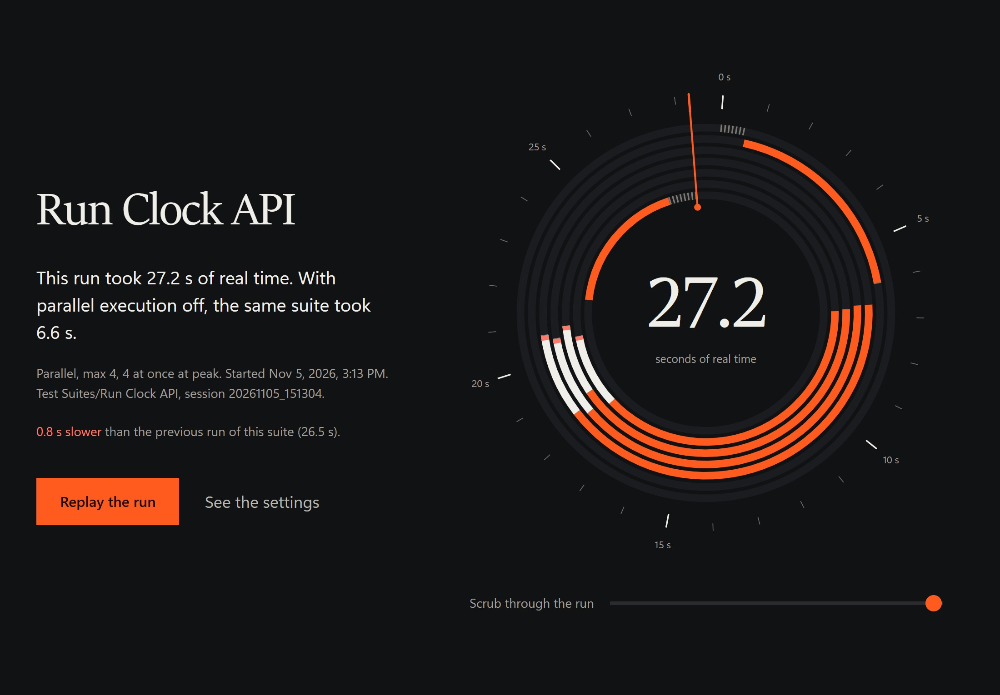</a>

</div>

<br>

## See it in action

<table width="100%">
<tr>
<td width="33.3%" valign="top">
  <strong>1 · Install with one command</strong><br><br>
  Run <code>npx katalon-run-clock install "C:\path\to\project"</code> — zero plugins and zero changes to existing Test Cases or Suites.
</td>
<td width="33.3%" valign="top">
  <strong>2 · Run normally, get answers</strong><br><br>
  Run any Suite or Collection as usual; Run Clock opens a self-contained offline <code>summary.html</code> in your browser automatically.
</td>
<td width="33.3%" valign="top">
  <strong>3 · Pick the fastest setting</strong><br><br>
  Stop guessing <i>Max Concurrent Instances</i>. See 5-run medians per setting, JVM start-up splits, and slower-than-usual alerts.
</td>
</tr>
</table>

<br>

<table>
  <tr>
    <td width="50%" valign="top"><a href="https://montbaga.github.io/katalon-run-clock/sample/Reports/20261105_151304/run-clock/summary.html#settings">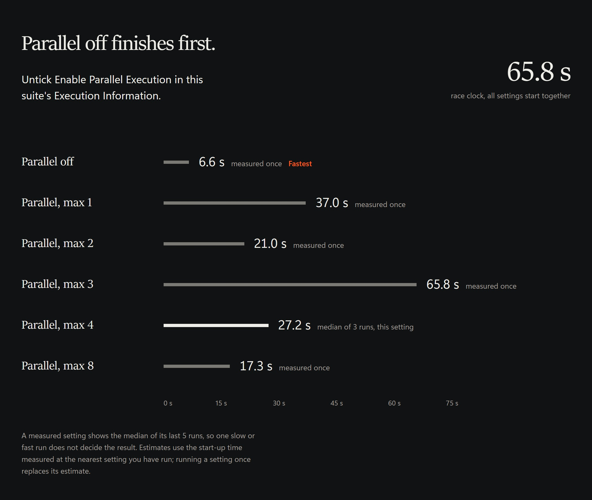</a><br><sub><b>Which setting wins:</b> All 6 settings raced on one clock — Parallel off wins in <b>6.6 s</b> vs 17.3 s–65.8 s parallel.</sub></td>
    <td width="50%" valign="top"><a href="https://montbaga.github.io/katalon-run-clock/sample/Reports/20261105_151304/run-clock/summary.html#time">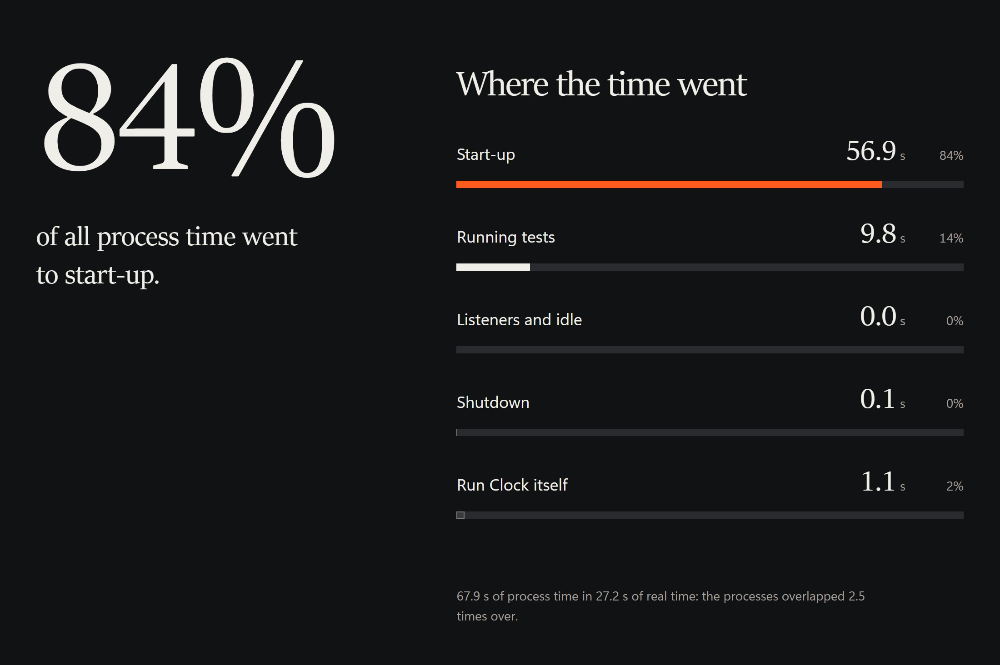</a><br><sub><b>Where the time went:</b> Exposes Java start-up (<b>84%</b>) vs actual test execution (14%), listeners, and shutdown.</sub></td>
  </tr>
  <tr>
    <td width="50%" valign="top"><a href="https://montbaga.github.io/katalon-run-clock/sample/Reports/20261105_155603/run-clock/summary.html#collection">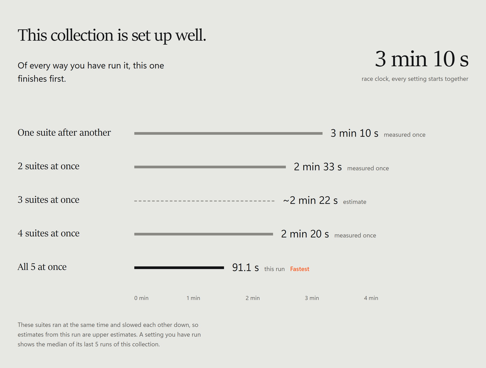</a><br><sub><b>Collection execution mode:</b> Raced on the collection's own clock — all 5 suites at once finishes in <b>91.1 s</b> vs 3 min 10 s sequential.</sub></td>
    <td width="50%" valign="top"><a href="https://montbaga.github.io/katalon-run-clock/sample/Reports/20261105_173339/run-clock/summary.html#timeline">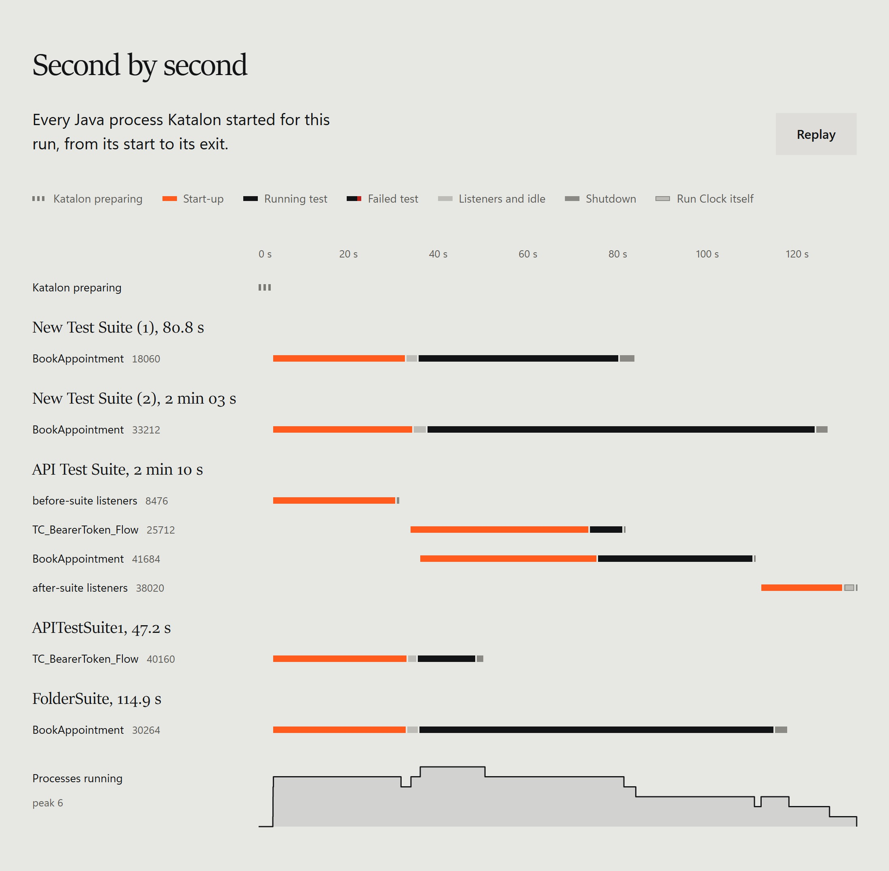</a><br><sub><b>Second-by-second JVM timeline:</b> Every Java process grouped by suite with live concurrency strip at the bottom.</sub></td>
  </tr>
</table>

<details>
<summary><b>Explore slower alerts, All-runs history, 2-run diff, phone UI &amp; 22-run verification matrix</b></summary>

<table>
  <tr>
    <td width="50%" valign="top"><a href="https://montbaga.github.io/katalon-run-clock/sample/Reports/20261105_191030/run-clock/summary.html">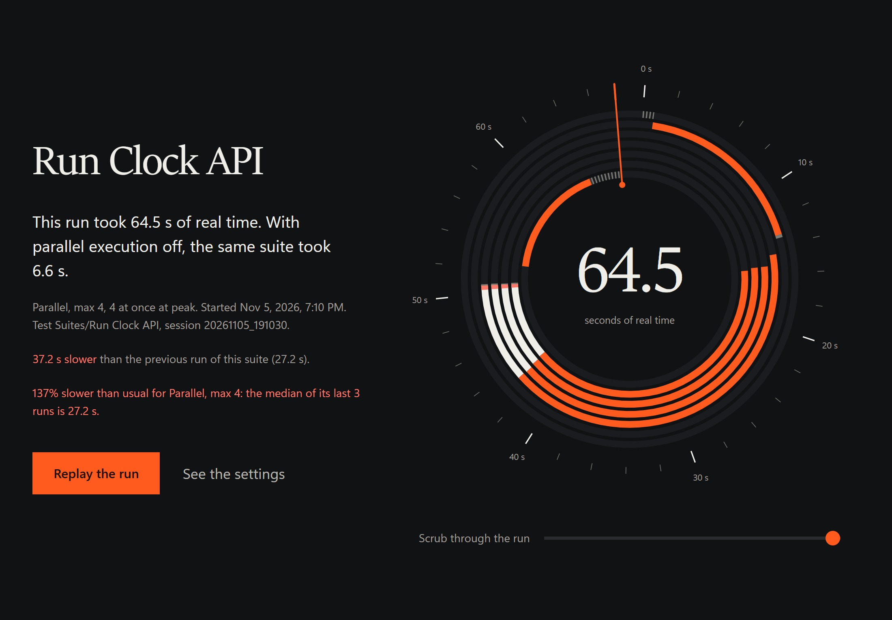</a><br><sub><b>Slower than usual alert:</b> Flags <b>137% slower</b> runs in the report, Log Viewer, and chat webhook.</sub></td>
    <td width="50%" valign="top"><a href="https://montbaga.github.io/katalon-run-clock/sample/Reports/run-clock/index.html#history">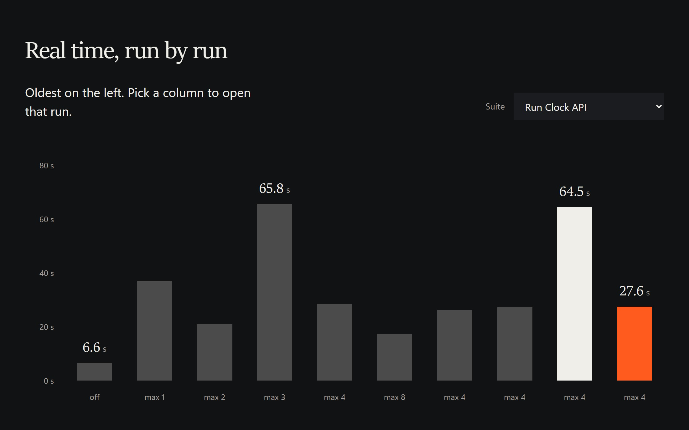</a><br><sub><b>All-runs trend (<code>Reports/run-clock/index.html</code>):</b> Track real elapsed time run by run per suite.</sub></td>
  </tr>
  <tr>
    <td width="50%" valign="top"><a href="https://montbaga.github.io/katalon-run-clock/sample/Reports/run-clock/index.html#compare">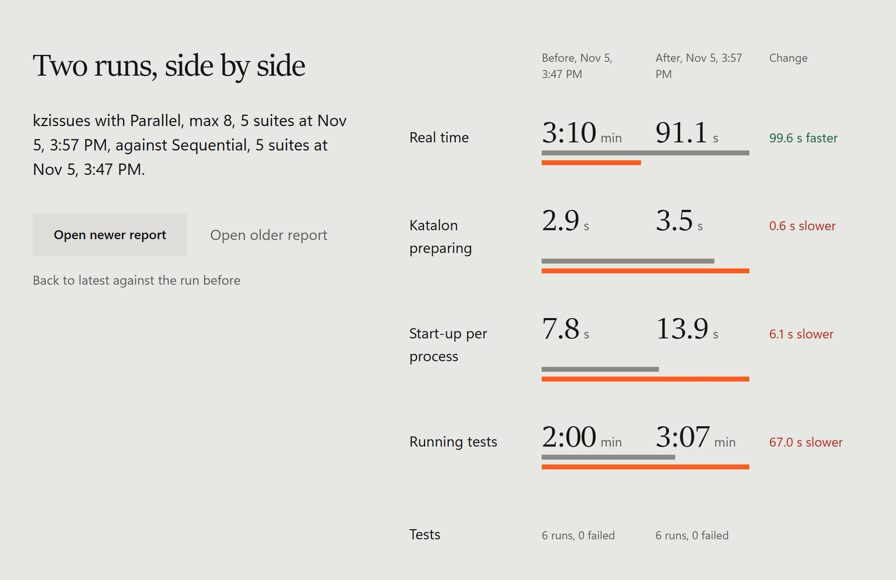</a><br><sub><b>Tick any two runs to compare:</b> Sequential 3 min 10 s vs Parallel all 5 at once in 91.1 s side by side.</sub></td>
    <td width="50%" valign="top">
      <table>
        <tr>
          <td>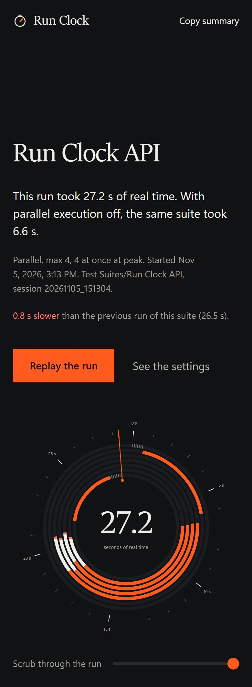</td>
          <td>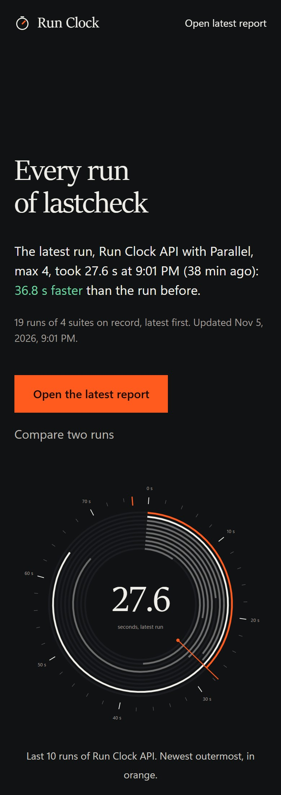</td>
        </tr>
      </table>
      <sub><b>Responsive mobile layout:</b> Both <code>summary.html</code> and <code>index.html</code> adapt cleanly on phone screens.</sub>
    </td>
  </tr>
</table>

### Verified on 22 real runs (Katalon Studio 11.6 Enterprise + Azure Pipelines)
All screenshots and live sample files in [`docs/sample`](docs/sample) and [`docs/screenshots`](docs/screenshots/README.md) come directly from real runs:

| Part | What was measured | Runs |
| :--- | :--- | :--- |
| **1 · Suites** | Two test suites, parallel off + max `1`, `2`, `3`, `4`, and `8` | `10` |
| **2 · Collections** | Two Test Suite Collections: Sequential vs Parallel max `2`, `4`, and `8` | `7` |
| **3 · History modes** | `history` set to `readonly` and `off` | `2` |
| **4 · Webhooks &amp; CLI** | Slack incoming webhook + console-mode `katalonc` run | `2` |
| **5 · Multi-OS CI** | KRE on Windows, Ubuntu &amp; macOS Azure agents (suite max `4` + 2-suite collection across 4 builds with cached history) | `22` total |

</details>

---

## Why parallel can be slower

<picture>
  <source media="(prefers-color-scheme: dark)" srcset="docs/images/five-pillars-dark.svg">
  <source media="(prefers-color-scheme: light)" srcset="docs/images/five-pillars-light.svg">
  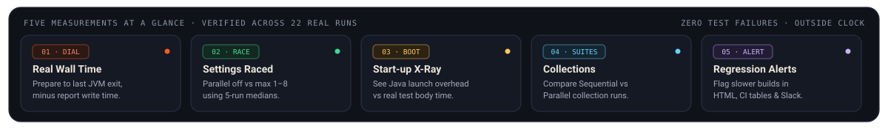
</picture>

<br><br>

| Problem | How Run Clock solves it |
| :--- | :--- |
| **Hidden JVM boot overhead** | Records the start and exit of every Java process and reports true wall time from Katalon preparing the run to the last process exiting |
| **No way to know if parallel actually helps** | Races every setting you have executed (median of last 5 runs each) and estimates untried settings |
| **Collection durations look misleading** | Clocks every suite on the collection's own shared timeline and compares Sequential vs Parallel at the collection level |
| **Single outlier runs distort benchmarks** | Uses rolling medians and flags builds slower than usual for that exact setting |
| **Timing tools shouldn't slow tests down** | Writes the HTML once after the last suite exits, excluding its own write duration (`~1.1 s`) from every figure |
| **Listener bugs must never fail tests** | Every entry point catches its own exceptions — recording stops cleanly and your tests continue undisturbed |

<details>
<summary><b>Requirements &amp; honest limits (Katalon 11+, Enterprise parallel note, Node 14+)</b></summary>

- **Katalon version:** Katalon Studio `11`, or Katalon Runtime Engine `11` for CLI/CI runs (tested on `11.6`).
- **Platforms:** Windows, macOS, and Linux (tested on Windows 11 and Microsoft-hosted Windows, Ubuntu, and macOS Azure agents).
- **Parallel requirement:** Parallel execution within a suite requires Katalon Studio `11.4+` and an **Enterprise** license; Run Clock measures non-parallel and collection runs without it.
- **Installer runtime:** Node.js `14+` for the installer only (tested on `14` and `24`). Zero runtime Node dependency during test execution.
- **Honest limits:**
  - Untried setting estimates (`~`) can be off by half or more since parallel JVMs contend for CPU/RAM — run a setting once to replace its estimate.
  - Time Katalon spends building its own native reports *after* the last JVM exits is outside listener visibility.
  - Run Clock's own write (`1–2 s` in a fresh after-suite process) is shown on the timeline and excluded from all elapsed figures.
  - Killed JVMs omit shutdown time and show running tests as incomplete; an aborted run writes on the next completed run.
  - Figures use **Sitka** (Windows serif) with clean serif fallbacks on macOS and Linux.

</details>

---

## Install &amp; uninstall

Needs **Node.js 14+** solely to copy or remove files (nothing runs on Node during Katalon tests). After installing or upgrading, right-click **Keywords**, **Test Listeners**, and **Include** in Katalon Studio's Tests Explorer and choose **Refresh** so Studio compiles the new files.

<table width="100%">
<tr>
<td width="33.3%" valign="top">
  <strong>1 · npx (Any OS)</strong><br><br>
  <pre>npx katalon-run-clock install &lt;dir&gt;
npx katalon-run-clock uninstall &lt;dir&gt;</pre>
  Upgrade via <code>npx katalon-run-clock@latest install &lt;dir&gt;</code>. Your settings survive intact.
</td>
<td width="33.3%" valign="top">
  <strong>2 · Git Clone / Local CLI</strong><br><br>
  <pre>node bin/cli.js install &lt;dir&gt;
node bin/cli.js uninstall &lt;dir&gt;</pre>
  Stops safely if the folder has no <code>*.prj</code> project file.
</td>
<td width="33.3%" valign="top">
  <strong>3 · GitHub Actions</strong><br><br>
  <pre>- uses: montbaga/katalon-run-clock@v1.0.0
  with:
    project-path: .</pre>
  Zero files to commit; auto-posts summary table to Job Summary.
</td>
</tr>
</table>

<details>
<summary><b>What the installer does &amp; all 6 installed files (preserves <code>runclock.properties</code>)</b></summary>

Pass your full Katalon project folder on Windows (`npx katalon-run-clock install "C:\path\to\your\katalon-project"`) or macOS/Linux (`npx katalon-run-clock install ~/Katalon/my-project`), or `'${{ github.workspace }}'` in GitHub Actions.

1. Verifies the target directory contains a `*.prj` Katalon project file before writing anything.
2. Copies the 6 files below into your project.
3. Preserves any existing `Include/config/runclock/runclock.properties` on upgrade **and** uninstall, along with every recorded folder under `Reports/`.

```text
Test Listeners/RunClockListener.groovy        auto-discovered by Katalon; four one-line hooks
Keywords/runclock/RunClockRecorder.groovy     records the events of each Java process into *.jsonl
Keywords/runclock/RunClockReport.groovy       computes times, medians, estimates & HTML/MD reports
Keywords/runclock/RunClockSettings.groovy     reads runclock.properties + RUN_CLOCK_* env overrides
Include/config/runclock/report.html           self-contained offline HTML report template
Include/config/runclock/runclock.properties   plain-English project configuration
```

</details>

---

## How it works &amp; configuration

<picture>
  <source media="(prefers-color-scheme: dark)" srcset="docs/images/lifecycle-flow-dark.svg">
  <source media="(prefers-color-scheme: light)" srcset="docs/images/lifecycle-flow-light.svg">
  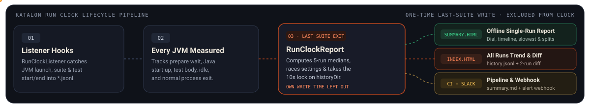
</picture>

<br><br>

- **Where files live:** Every Katalon run folder (`Reports/<timestamp>/run-clock/`) receives `summary.html`, `summary.txt`, `summary.md`, and raw `*.jsonl` event logs, while project history (`Reports/run-clock/`) stores `index.html`, `history.jsonl`, `runs.jsonl`, `tests/`, and `ci-summary.md`.
- **Log Viewer output:** At the end of every run (under the final suite for collections), Run Clock prints the complete timing and setting breakdown directly into Katalon's Log Viewer:

```text
Run Clock | Run Clock API | 20261105_151304
Parallel, Max Concurrent Instances 4, peak 4 at once

Elapsed                     27.2 s   run start to last process exit, without Run Clock itself
Before first process         0.6 s   Katalon preparing the run
Processes                        6   4 with tests, 2 listener-only
Start-up                    11.7 s   median, process start to first listener call
Shutdown                     0.0 s   median, last listener call to process exit
Tests                        9.8 s   4 runs, longest 2.6 s
Run Clock itself             1.1 s   writing this report, left out of every time here

Setting                       Time
Parallel off                 6.6 s   measured once
Parallel, max 1             37.0 s   measured once
Parallel, max 2             21.0 s   measured once
Parallel, max 3             65.8 s   measured once
Parallel, max 4             27.2 s   median of 3 runs, this setting
Parallel, max 8             17.3 s   measured once

Fastest: Parallel off (Enable Parallel Execution unticked).
```

<details>
<summary><b>Benchmarks, collections, slower-test detection, 40+ process view &amp; sharing safety</b></summary>

- **Medians &amp; estimates:** Each measured setting displays the median of its **last 5 runs** so transient machine spikes do not flip recommendations. Unmeasured settings under *Test Suite → Execution Information* are estimated from nearest-neighbor JVM start-up plus test durations across parallel slots.
- **Test Suite Collections:** Sequential runs estimate `2`, `3`, or `4` suites at once; Parallel runs estimate sequential execution. Recommendations trigger when another mode is at least **15% faster** (always confirm once since co-scheduled suites share CPU/memory).
- **Per-test diagnostics &amp; machine splits:** After `3` runs with history on, tests exceeding their usual duration by `slowerBy%` (`≥ 1 s`) are surfaced. Suites with `≥ 6` tests and `≥ 1 min` of test duration receive balanced split plans for `2`, `3`, or `4` CI machines.
- **Slower-than-usual run alerts:** Fires when a run exceeds the 5-run setting median by `slowerBy%` (and `≥ 2 s`), once at least `3` prior runs exist for that setting.
- **Large suites (`> 40` processes):** Switches the dial to active/booting/running density bands, draws compact timeline tracks per process, and paginates tables at `20` rows.
- **Strict offline privacy:** `summary.html` embeds a network-blocking Content Security Policy with zero external assets, local paths, credentials, or test data (only suite/test names, PIDs, and timings).

</details>

<details>
<summary><b>Configuration (<code>Include/config/runclock/runclock.properties</code>, <code>RUN_CLOCK_*</code> env vars &amp; history files)</b></summary>

Precedence order (invalid values fall through automatically): **Environment variable → `runclock.properties` → built-in default**.

| Key | Env Override | Default | Meaning |
| :--- | :--- | :--- | :--- |
| `openReport` | `RUN_CLOCK_OPEN` | `studio` | `studio` (open in IDE runs), `always` (desktop KRE too), or `never` |
| `history` | `RUN_CLOCK_HISTORY` | `on` | `on`, `readonly`, or `off` |
| `historyDir` | `RUN_CLOCK_HISTORY_DIR` | `Reports/run-clock` | Project-relative or absolute history folder |
| `historyLimit` | `RUN_CLOCK_HISTORY_LIMIT` | `50` | Runs remembered per suite (`5`–`1000`; `5000` global cap) |
| `slowerBy` | `RUN_CLOCK_SLOWER_BY` | `25` | Percent slower than median required to alert |
| `webhookUrl` | `RUN_CLOCK_WEBHOOK` | *(empty)* | Slack-compatible incoming webhook URL (set in CI secrets) |
| `ciSummary` | `RUN_CLOCK_CI_SUMMARY` | `on` | Write `summary.md` / `ci-summary.md` markdown summaries |

| `history` | Behavior | Best Used For |
| :--- | :--- | :--- |
| `on` | Reads prior runs, compares medians, and appends this run + `index.html` | Local Studio runs and `main` CI branch builds |
| `readonly` | Compares against `main` history without mutating it | Pull request and feature branch builds |
| `off` | No reads or writes; each report stands completely alone | Teams opting out of trend storage |

History folder (`historyDir`) writes take a **10-second file lock** so concurrent suites never corrupt shared JSONL (`history.jsonl` up to `historyLimit`/`5000`, per-suite `tests/` last `20` runs, `runs.jsonl` last `1000` runs, `index.html`, `ci-summary.md`).

</details>

---

## Run Clock in CI

Run Clock lives inside your Katalon project, so CI pipelines need nothing extra — KRE builds automatically write `ci-summary.md` markdown tables onto build pages and package offline `summary.html` artifacts without ever attempting to open a browser. Choose CI parallel settings from CI agents directly: hosted Ubuntu agents averaged **`19.5 s`** Java start-up vs **`11.7 s`** on Windows 11 desktop.

<table>
  <tr>
    <td width="50%" valign="top">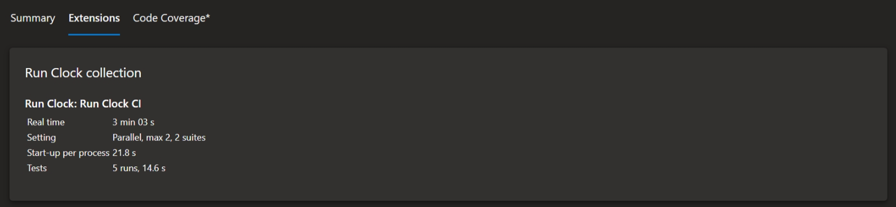<br><sub><b>Pipeline build summary:</b> Appears on Azure DevOps Extensions tab and GitHub Job Summary with usual-time comparison from build #2.</sub></td>
    <td width="50%" valign="top">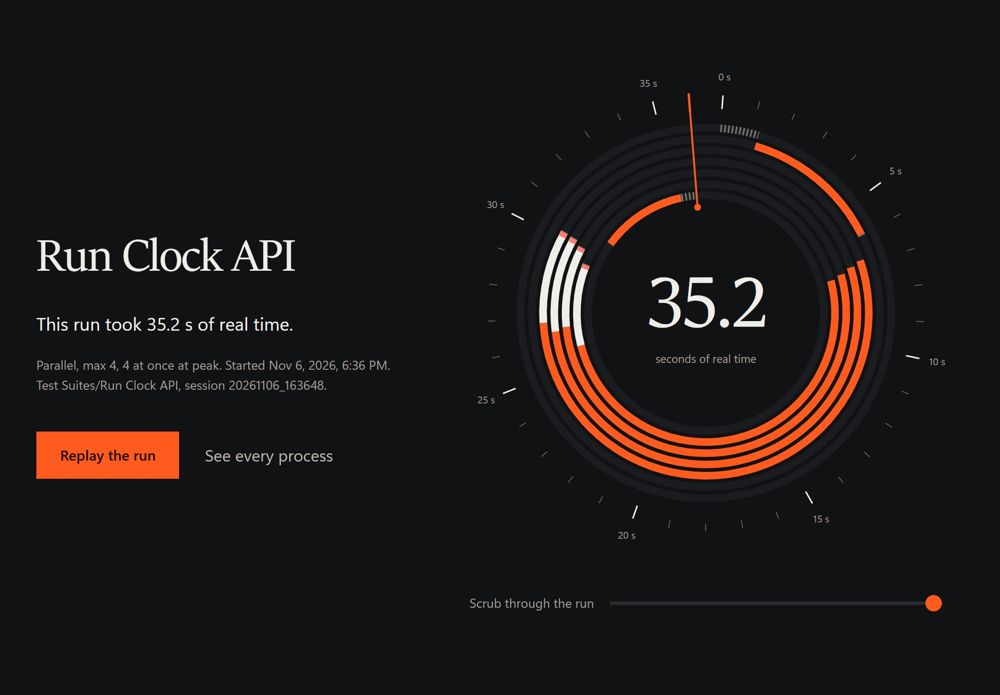<br><sub><b>Ubuntu artifact report (<code>35.2 s</code>):</b> Full offline <code>summary.html</code> inside every build artifact bundle.</sub></td>
  </tr>
</table>

<details>
<summary><b>Complete CI setup guides (Azure Pipelines + cache job, GitHub Actions, GitLab/Jenkins &amp; Slack webhooks)</b></summary>

### Azure Pipelines ([`examples/azure-pipelines.yml`](examples/azure-pipelines.yml))
1. Run `npx katalon-run-clock install "C:\path\to\your\katalon-project"` and commit `Test Listeners/`, `Keywords/runclock/`, and `Include/config/runclock/`.
2. Copy [`examples/azure-pipelines.yml`](examples/azure-pipelines.yml) as `azure-pipelines.yml`, point to your `-testSuitePath` or `-testSuiteCollectionPath`, install the Katalon for Azure DevOps extension, and create variable group `katalon` containing secret `KatalonApiKey`.
3. Handles Windows, Ubuntu (virtual display + Java 21), and macOS agents cleanly — keeping per-OS history (`on` on `main`, `readonly` on PRs) and saving caches even when tests fail via the trailing `keep_history` job:

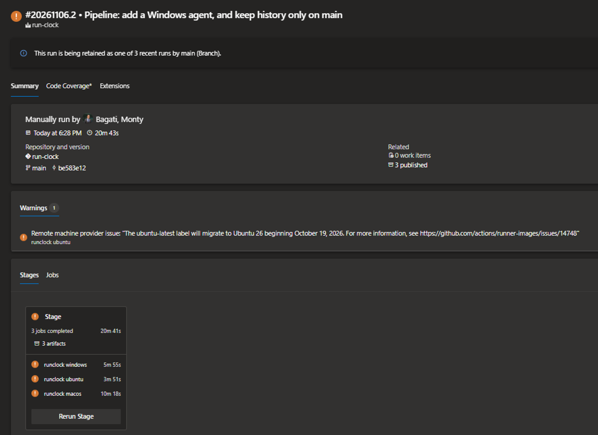

### GitHub Actions ([Marketplace Action](https://github.com/marketplace/actions/katalon-run-clock))
```yaml
- uses: montbaga/katalon-run-clock@v1.0.0
  with:
    project-path: ${{ github.workspace }}
```
Use `actions/cache/restore` before Katalon and `actions/cache/save` with `if: always()` after it so failed test runs still preserve `Reports/run-clock` history. On self-hosted agents, point `RUN_CLOCK_HISTORY_DIR` at a persistent folder on disk.

### GitLab CI, Jenkins &amp; Slack Webhooks
- **GitLab / Jenkins / Other CI:** Cache `Reports/run-clock` between builds and toggle `RUN_CLOCK_HISTORY=on|readonly` by branch.
- **Slack-compatible webhooks:** Set secret `RUN_CLOCK_WEBHOOK` to receive a one-line alert per run (on Azure Pipelines, pass `env: RUN_CLOCK_WEBHOOK: $(RUN_CLOCK_WEBHOOK)` explicitly to the Katalon task).

</details>

---

## Troubleshooting, limits &amp; license

<details>
<summary><b>Troubleshooting (no auto-open, unrefreshed files, collection skips, missing history, <code>[RunClock]</code> logs)</b></summary>

- **No report opened after a run:** Check `openReport` in `runclock.properties` (`studio` skips CLI/KRE). The file is still generated under `Reports/<run>/run-clock/summary.html`.
- **Nothing changed after installing/upgrading:** In Katalon Studio Tests Explorer, right-click **Keywords**, **Test Listeners**, and **Include** → **Refresh** (or reopen the project).
- **`Run Clock: the report is written when the last suite of this collection finishes.`:** Normal inside collection runs — only the final suite writes the unified collection report.
- **Missing runs on `index.html`:** That run used `history=readonly` / `off`, or its timestamped folder under `Reports/` was removed locally.
- **`[RunClock]` messages in console:** Diagnostic warnings (such as failing to acquire the 10-second history lock); Run Clock catches every internal error and never fails a test case.

</details>

<details>
<summary><b>License (<code>Apache-2.0</code>) &amp; Architecture internals</b></summary>

- **License ([`LICENSE.md`](LICENSE.md)):** Apache License 2.0 — free to use, modify, and distribute. Copyright 2026 Monty Bagati.
- **Design docs ([`ARCHITECTURE.md`](ARCHITECTURE.md)):** Deep dive on process event JSONL schemas, locking, median/estimate math, and HTML template generation.

</details>

---

## Let's talk

<div align="center">

<picture>
  <source media="(prefers-color-scheme: dark)" srcset="docs/images/contact-card-dark.svg">
  <source media="(prefers-color-scheme: light)" srcset="docs/images/contact-card-light.svg">
  
</picture>

<br><br>

<a href="mailto:bagati.monty@gmail.com?subject=Katalon%20Run%20Clock%20%E2%80%94%20Hello%20Monty"></a>
&nbsp;
<a href="https://www.linkedin.com/in/monty-bagati-90454626/"></a>
&nbsp;
<a href="https://github.com/montbaga"></a>
&nbsp;
<a href="https://github.com/montbaga/katalon-run-clock/issues/new"></a>

<br><br>

**Katalon Run Clock `v1.0.0`** · Built by [**Monty Bagati**](https://www.linkedin.com/in/monty-bagati-90454626/)  
<sub>Apache License 2.0 · Copyright 2026 Monty Bagati</sub>

</div>
