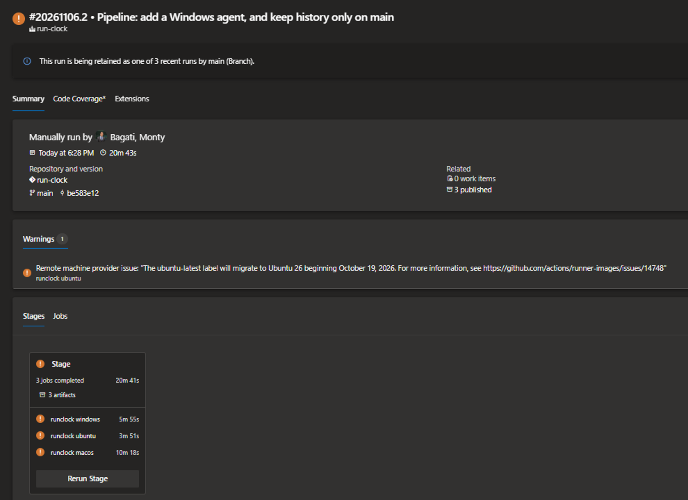
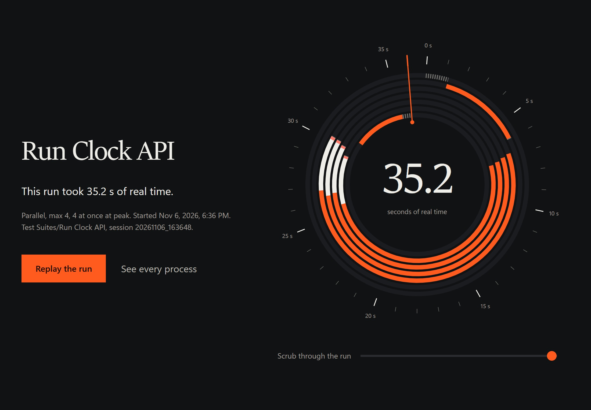

# Katalon Run Clock

[](https://katalon.com/katalon-studio)
[](https://nodejs.org)
[](#run-clock-in-ci)
[](https://www.npmjs.com/package/katalon-run-clock)
[](LICENSE.md)

Shows how long a Katalon Studio run really took, where the time went, and
whether parallel execution makes each test suite and Test Suite Collection
faster or slower. A drop-in Test Listener: no plugin, no changes to your
Test Cases or Test Suites.

**[See it in action](#see-it-in-action)** ·
**[Install](#install--uninstall)** ·
**[CI pipelines](#run-clock-in-ci)** ·
**[Configuration](#configuration)** ·
**[Troubleshooting](#troubleshooting)** ·
**[Architecture](ARCHITECTURE.md)**


## See It in Action

**1. Install with one command**

```
npx katalon-run-clock install "C:\path\to\your\katalon-project"
```

**2. Run a test suite or collection as you always do**

When the run finishes, its report opens in your browser.

**3. See which setting is fastest**

Every parallel setting of the suite, raced on one clock. For these four
short API tests, running them one after another wins: 6.6 s, against
17.3 s at best with parallel execution on.


**4. See where the time went**

In a parallel run, most of the process time can be Java start-up rather
than testing. In this run, 84% of it was.


**5. For a Test Suite Collection, compare its own Execution mode**

Every way you have run the collection, side by side. All five suites at
once took 91.1 s, against 3 min 10 s one after another.


Every Java process of the run, second by second, grouped by suite:


**6. Get told when a run is slower than usual**

The report, the Log Viewer and the chat message all say so.


**7. Find every run in one place**

`Reports/run-clock/index.html` lists every run in the project. Pick a suite
to see its real time run by run, or tick two runs to compare them.


**On a phone**

<table>
<tr><th>A run's report</th><th>All runs</th></tr>
<tr>
<td></td>
<td></td>
</tr>
</table>

## Verified on real runs

Every image above is from a real run in Katalon Studio 11.6 Enterprise on
Windows 11. The full set, with each run's setting and real time, is in
[`docs/screenshots`](docs/screenshots/README.md):

| Part | What was run | Runs |
|---|---|---|
| 1 | Two test suites, with parallel off and with max 1, 2, 3, 4 and 8 | 10 |
| 2 | Two Test Suite Collections, Sequential and Parallel with max 2, 4 and 8 | 7 |
| 3 | The `history` setting set to `readonly`, then `off` | 2 |
| 4 | A chat webhook, and a command-line run with `katalonc` | 2 |
| 5 | Katalon Runtime Engine on Windows, Ubuntu and macOS agents in Azure Pipelines: a suite with max 4 and a collection of two suites at once, on each | 10 |

## Why this exists

Katalon 11.4+ can run the test cases of a suite in parallel, but each test
case gets its own Java process. For short tests, starting those processes
can take longer than the tests themselves, and the run gets slower instead
of faster.

| Problem | How Run Clock solves it |
|---|---|
| The time spent starting a process for every test case is hard to see | Records the start and exit of every Java process and reports the real time, from Katalon preparing the run to the last process exiting |
| No way to tell whether parallel execution helps a suite | Races every setting you have run (median of the last 5 runs each) and estimates the ones you have not |
| Test Suite Collection totals can be lower than the time the run took | Measures each suite on the collection's own clock, and compares Sequential with Parallel for the collection itself |
| One slow run can mislead | Compares medians, and flags a run that is slower than usual for its setting |
| A timing tool must not slow the run down | Writes its report once per run, after the tests, and leaves that time out of every figure |
| A reporting bug must not fail a test | Every entry point catches its own errors; recording stops and the test carries on |

## Requirements

- Katalon Studio 11, or Katalon Runtime Engine 11 for command-line and CI
  runs. Tested on 11.6.
- Windows, macOS or Linux. Tested on Windows 11, and on Windows, Ubuntu
  and macOS agents in Azure Pipelines.
- Parallel execution within a suite needs Katalon Studio 11.4+ and an
  Enterprise licence. Run Clock also measures runs without it.
- Node.js, any version from 14 on, for the installer only (tested on 24).

## Install / Uninstall

**With npx:**

```
npx katalon-run-clock install "C:\path\to\your\katalon-project"
npx katalon-run-clock uninstall "C:\path\to\your\katalon-project"
```

On macOS or Linux, use that system's path, for example
`npx katalon-run-clock install ~/Katalon/my-project`. To upgrade, run
`npx katalon-run-clock@latest install` with the same folder.

**From a copy of this repository:**

```
node bin/cli.js install "C:\path\to\your\katalon-project"
node bin/cli.js uninstall "C:\path\to\your\katalon-project"
```

Then in Katalon Studio's Tests Explorer, right-click **Keywords** and
choose **Refresh**, then do the same for **Test Listeners** and
**Include**. Studio does not notice files added from outside until you do.
Do the same after an upgrade.

## What the installer actually does

1. Checks that the folder is a Katalon project (it has a `*.prj` file)
   before writing anything, and stops otherwise.
2. Copies the six files below into the project.
3. Keeps an existing `runclock.properties`, so your settings survive an
   upgrade.
4. Running it again upgrades the project in place.

Uninstalling removes the same files and keeps your `runclock.properties`
and every recorded run under `Reports/`.

## What gets installed

```
Test Listeners/RunClockListener.groovy        auto-discovered by Katalon; four one-line hooks
Keywords/runclock/RunClockRecorder.groovy     records the events of each Java process
Keywords/runclock/RunClockReport.groovy       works out the times, advice and history; writes the reports
Keywords/runclock/RunClockSettings.groovy     reads runclock.properties and RUN_CLOCK_* environment variables
Include/config/runclock/report.html           the report page template
Include/config/runclock/runclock.properties   your settings, each one described in the file
```

## Using it

Run any test suite or collection as usual. When a run started from Katalon
Studio finishes, its report opens in your browser. Runs from Katalon
Runtime Engine and CI servers never open a browser.

Each run's report is `Reports/<run>/run-clock/summary.html`, inside
Katalon's own folder for that run. Every run is also listed in
`Reports/run-clock/index.html`, newest first. From there you can open any
run's report, pick a suite to see its real time across runs, or tick two
runs to compare them. Runs disappear from the list when you delete their
folder under `Reports`, except runs from CI builds.

To compare settings for a suite, run it once with each setting you want
measured. The setting is under Test Suite > Execution Information >
Enable Parallel Execution / Max Concurrent Instances.

**In the Log Viewer.** The same summary appears at the end of each run; for
a collection, under its last suite. Real output for a suite of four short
API tests, after running each setting at least once:

```
Run Clock | Run Clock API | 20261105_151304
Parallel, Max Concurrent Instances 4, peak 4 at once

Elapsed                     27.2 s   run start to last process exit, without Run Clock itself
Before first process         0.6 s   Katalon preparing the run
Processes                        6   4 with tests, 2 listener-only
Start-up                    11.7 s   median, process start to first listener call
Shutdown                     0.0 s   median, last listener call to process exit
Tests                        9.8 s   4 runs, longest 2.6 s
Run Clock itself             1.1 s   writing this report, left out of every time here

Setting                       Time
Parallel off                 6.6 s   measured once
Parallel, max 1             37.0 s   measured once
Parallel, max 2             21.0 s   measured once
Parallel, max 3             65.8 s   measured once
Parallel, max 4             27.2 s   median of 3 runs, this setting
Parallel, max 8             17.3 s   measured once

Fastest: Parallel off (Enable Parallel Execution unticked).
```

**How settings are compared.** The same suite with the same setting can
take very different times from one run to the next, mostly because process
start-up varies. So a setting you have run is shown as the median of its
last 5 runs, and the fastest setting is chosen from those medians. Run a
setting two or three times before acting on a close result. A setting you
have not run yet is estimated from the start-up time measured at the
nearest setting you have run, plus your test durations spread across the
parallel slots. Running a setting once replaces its estimate.

**Test Suite Collections.** A collection run gives one report: when each
suite started and finished on the collection's clock, a timeline of every
process grouped by suite, and the slowest tests across all its suites. The
report also compares the collection's own Execution mode. After a
Sequential run it estimates 2, 3 or 4 suites at once; after a Parallel run
it estimates one suite after another. A way you have already run shows the
median of its last 5 runs instead. When another way is at least 15% faster,
it says which setting to change. Suites on one machine slow each other
down, so run a suggested setting once to measure it before you keep it.

**The tests.** Every report lists the slowest tests. Once a suite has run
three times with history on, tests that took `slowerBy` percent longer than
their usual time (and at least a second longer) are listed. For a suite
with at least six tests and a minute of test time, the report also shows
how to split it evenly over 2, 3 or 4 machines.

**Slower than usual.** When a run's real time is `slowerBy` percent above
the median of its last five runs with the same setting, and at least two
seconds above it, the report, the Log Viewer and the chat message say so.
It needs three earlier runs with that setting.

**Large suites.** Katalon starts one process per test case in a parallel
suite, so 300 tests are 300 processes. Above 40 processes the dial shows
how many were starting up, running tests and alive at each moment, the
timeline uses one thin row per process, and the tables show their first 20
rows with a button for the rest.

## Configuration

Edit `Include/config/runclock/runclock.properties` in Katalon Studio
(Tests Explorer > Include > config > runclock). Each setting can also be
set by an environment variable, which wins over the file. That is how a CI
pipeline changes a setting without touching the project. A value that is
not valid is skipped, and the next one in line is used: the environment
variable, then the file, then the default.

| Key | Environment variable | Default | Meaning |
|---|---|---|---|
| `openReport` | `RUN_CLOCK_OPEN` | `studio` | `studio`: open the report after runs started from Katalon Studio. `always`: also Katalon Runtime Engine runs on a desktop. `never`: do not open it |
| `history` | `RUN_CLOCK_HISTORY` | `on` | `on`, `readonly` or `off`, see Keeping runs below |
| `historyDir` | `RUN_CLOCK_HISTORY_DIR` | `Reports/run-clock` | Where the history is kept, relative to the project or absolute |
| `historyLimit` | `RUN_CLOCK_HISTORY_LIMIT` | `50` | Runs of each suite to remember, 5 to 1000 |
| `slowerBy` | `RUN_CLOCK_SLOWER_BY` | `25` | Percent longer than usual that counts as slower |
| `webhookUrl` | `RUN_CLOCK_WEBHOOK` | *(empty)* | A Slack-compatible incoming webhook for a one-line message per run. Keep it out of source control; set it in your CI instead |
| `ciSummary` | `RUN_CLOCK_CI_SUMMARY` | `on` | Write `summary.md` for CI pages and the GitHub Actions job summary |

### Keeping runs

Each run's report is the archive. It lives in Katalon's own folder for that
run, so it is kept as long as Katalon's report is. The history is what Run
Clock learns from, and you choose what happens to it with `history`:

| `history` | What happens | Use it for |
|---|---|---|
| `on` | Every run is compared with earlier runs, then added to the history and the All runs page | Your own machine, and the CI builds of your main branch |
| `readonly` | Every run is compared with earlier runs, but nothing is written | Pull-request and feature-branch builds, so they are measured against the main branch without changing it |
| `off` | No history is read or written. Each report stands alone | Teams that do not want earlier runs kept |

The history folder (`historyDir`) holds:

| File | Kept |
|---|---|
| `history.jsonl`: one line per run, used for medians and estimates | The newest `historyLimit` runs of each suite, 5000 in all |
| `tests/`: each test's time per run, one file per suite | The newest 20 runs of each suite |
| `runs.jsonl`: the list behind the All runs page | Runs whose report folder still exists, and every run from a CI build; newest 1000 |
| `index.html`: the All runs page | Rewritten after every run |
| `ci-summary.md`: the latest run's summary | Rewritten after every run |

Writes to the history are locked, so suites finishing at the same moment
cannot overwrite each other. If the lock cannot be taken within 10
seconds, the run's own report is still written and only the history is
skipped.

## Run Clock in CI

Run Clock lives in your project, so a CI build needs no install step:
commit the files the installer adds, and every build that runs Katalon
records its own times. On a CI agent it never opens a browser.

| Where | What you get |
|---|---|
| The build's page | Real time, setting, start-up per process and test time. On Azure Pipelines it is on the Extensions tab |
| The build's artifacts | Each run's full report, `Reports/<run>/run-clock/summary.html`: one file that opens offline |
| The Katalon log | The same summary as in the Log Viewer |

The same suite and collection, run on Windows, Ubuntu and macOS agents one
after another:



The report the Ubuntu agent wrote, from the build's artifacts:



### Azure Pipelines

[`examples/azure-pipelines.yml`](examples/azure-pipelines.yml) is a
complete pipeline, tested on Windows, Ubuntu and macOS agents. Change
`Test Suites/Smoke` to your suite, or use `-testSuiteCollectionPath` for
a collection. On Linux, Katalon itself needs a display and Java 21, so the
pipeline starts Xvfb and switches to Java 21 there first.

### Other CI tools

Run Clock runs inside Katalon, not in the pipeline, so it works the same
in GitHub Actions, GitLab CI, Jenkins or any tool that runs Katalon Runtime
Engine. Keep `Reports/run-clock` between builds with that tool's cache, as
below. On GitHub Actions, the summary appears on the job's summary page by
itself.

### Keeping history between builds

A CI agent starts empty. Without help, every build looks like the first:
no medians, no "slower than usual", and settings you ran in earlier builds
show as estimates. Two things fix that:

1. **Keep the history folder.** Restore `Reports/run-clock` before Katalon
   runs and save it after, with the CI tool's cache. Keep one cache for
   each operating system: start-up times on a Linux agent and a macOS agent
   are too different to share medians.
2. **Let only main add to it.** Set `RUN_CLOCK_HISTORY` to `on` for main
   and `readonly` for every other branch. A pull request is then compared
   with main's runs without changing them.

Azure saves a cache only when its job succeeds, so the example saves the
history in a second small job that always runs. A build whose tests fail
stays red and still keeps its run.

Runs recorded on a CI agent stay on the All runs page and in every
comparison, even though the next build does not have their report folders.
They are listed without a link to their report.

On a self-hosted agent, you can skip the cache: set
`RUN_CLOCK_HISTORY_DIR` to a folder the agent keeps between builds.

To post each run to Slack, add your incoming webhook address as a secret
variable named `RUN_CLOCK_WEBHOOK`. On Azure Pipelines, also map it in the
Katalon step with `env: RUN_CLOCK_WEBHOOK: $(RUN_CLOCK_WEBHOOK)`, because
Azure does not pass secrets to tasks on its own.

## Sharing a report

`summary.html` is one file with no external resources and a content
security policy that blocks all network access, so it opens offline and
cannot send anything anywhere. It contains your suite and test case names,
process IDs and timings, but no file paths from your machine, credentials
or test data. Check the names are fine to share before posting a report
publicly.

## Limits

- Time Katalon spends generating its own reports after the last process
  exits is not included.
- Run Clock writes its report inside the after-suite process, once per run.
  That takes a second or two in a fresh process; it is measured, shown on
  the timeline, and left out of the real time and of every comparison.
- If a process is killed rather than exiting normally, its shutdown time
  is not recorded, and a test it was running is shown as incomplete.
- A run stopped before its last suite finishes has no report until the next
  run in the project finishes, which writes it.
- The report's figures use Sitka, a serif that comes with Windows. Other
  systems show their own serif.

## Troubleshooting

**No report opened after a run.** Check `openReport` in
`runclock.properties`; runs from Katalon Runtime Engine and CI never open
one. The report is still written to `Reports/<run>/run-clock/summary.html`.

**Nothing changed after installing or upgrading.** Katalon Studio compiles
only the files it knows about. Right-click **Keywords**, **Test Listeners**
and **Include** in Tests Explorer and choose **Refresh**, or close and
reopen the project.

**`Run Clock: the report is written when the last suite of this collection
finishes.`** in the Log Viewer of a collection's suite. Expected: only the
last suite to finish writes the collection's report, so the others skip it.

**The All runs page does not list a run.** That run had `history` set to
`readonly` or `off`, or its folder under `Reports` was deleted.

**Messages starting with `[RunClock]`** in the console explain anything
Run Clock could not do, such as a history file it could not lock. Run
Clock never fails or changes a test because of them.

## Support

Questions, bug reports, or help setting Run Clock up in a CI pipeline:
**bagati.monty@gmail.com**.

## License

Apache License 2.0: free to use, change and share. See
[`LICENSE.md`](LICENSE.md).

Copyright 2026 Monty Bagati.
