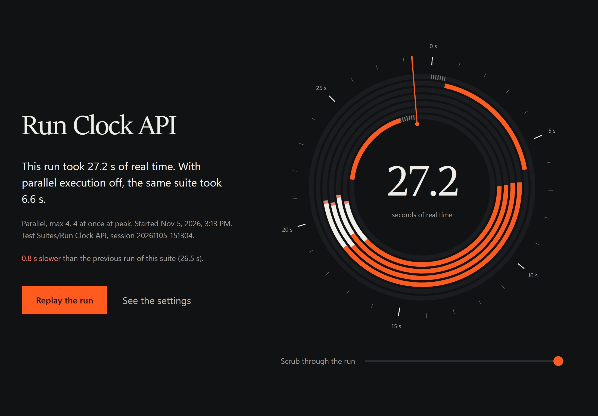
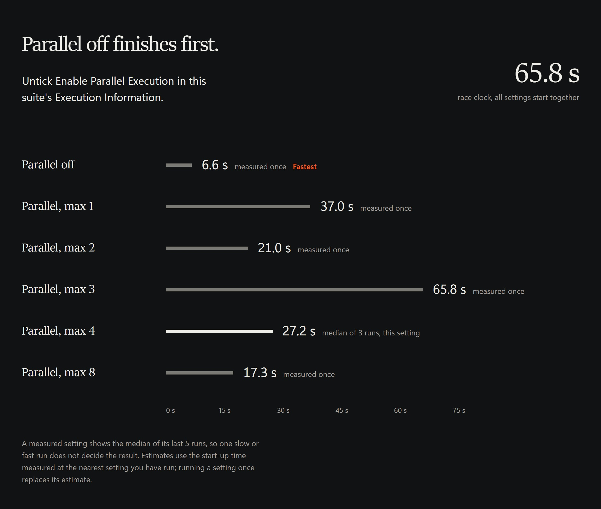
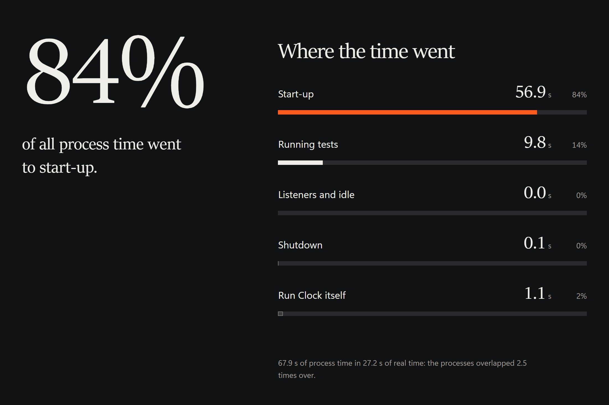
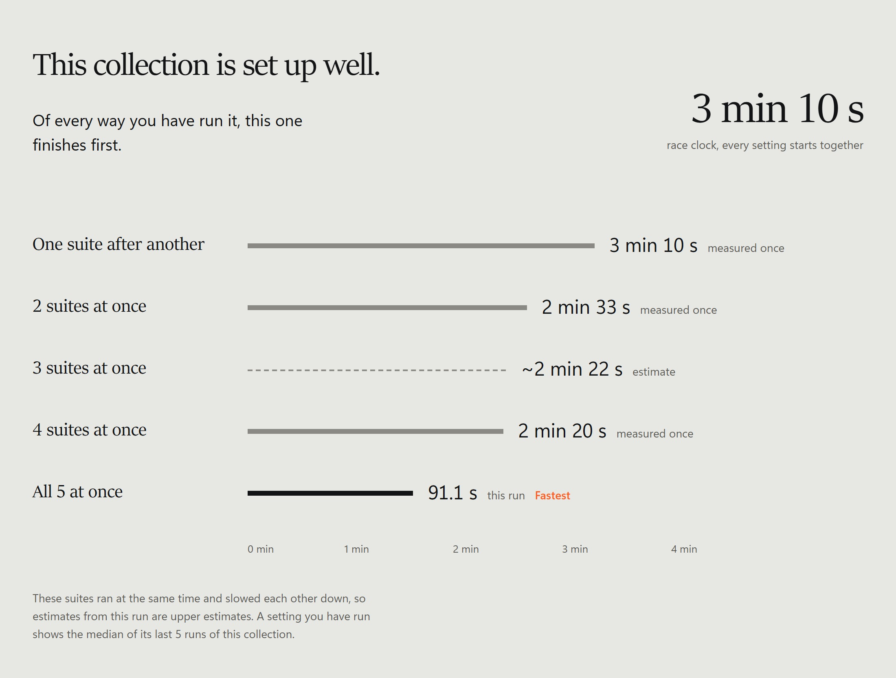
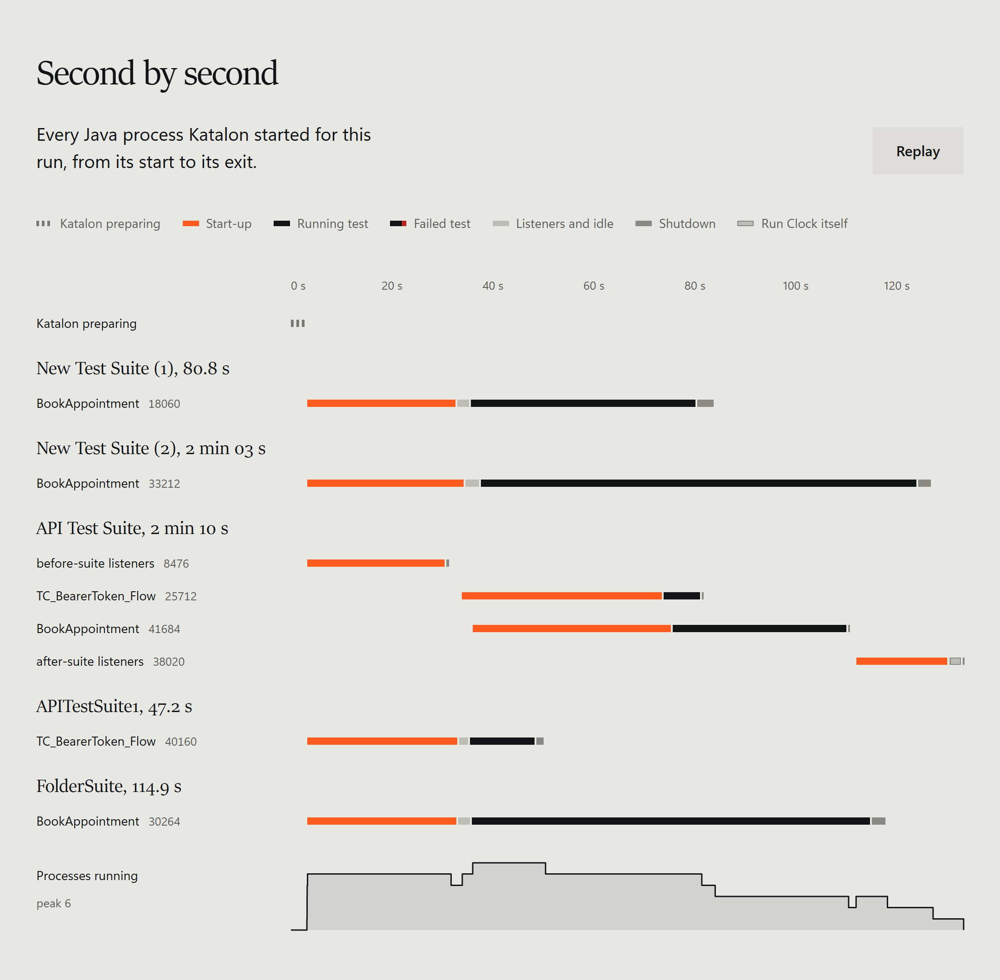
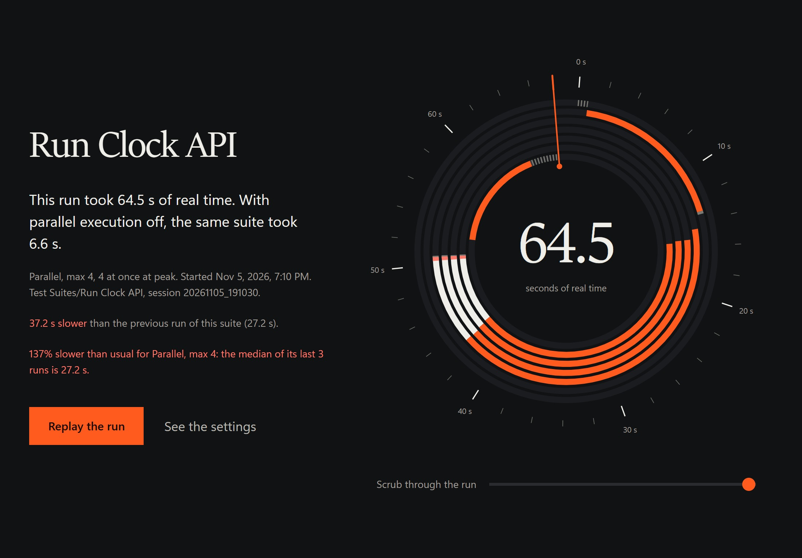
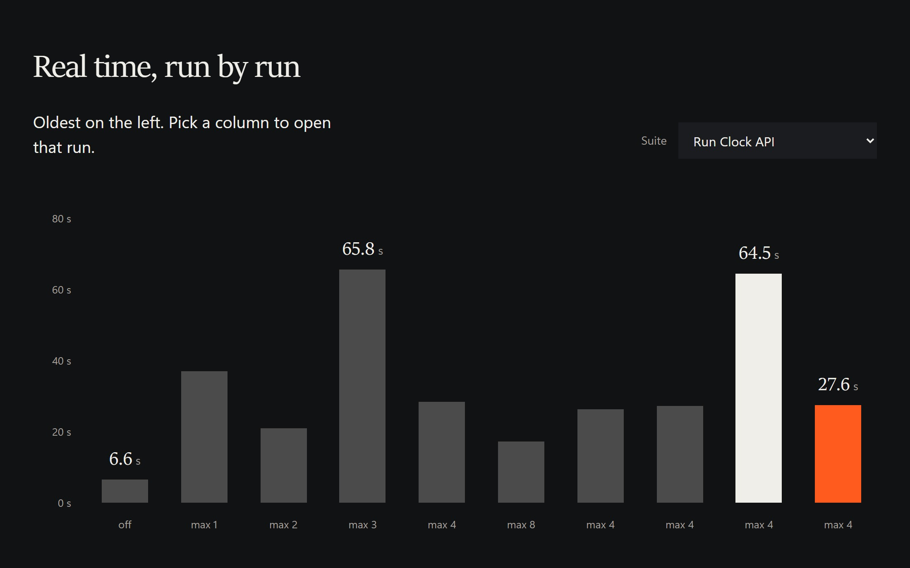
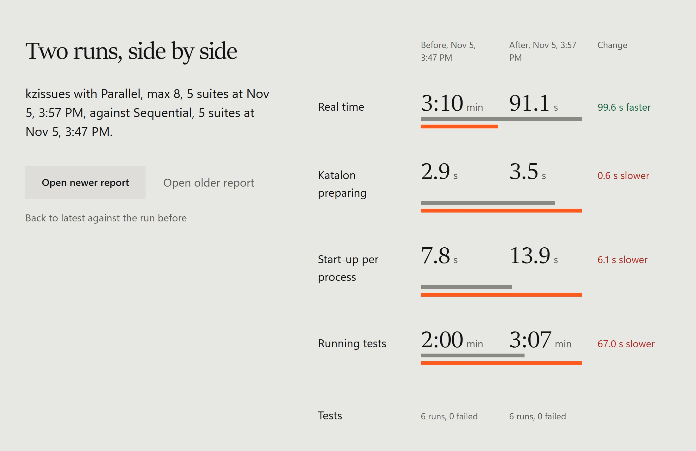
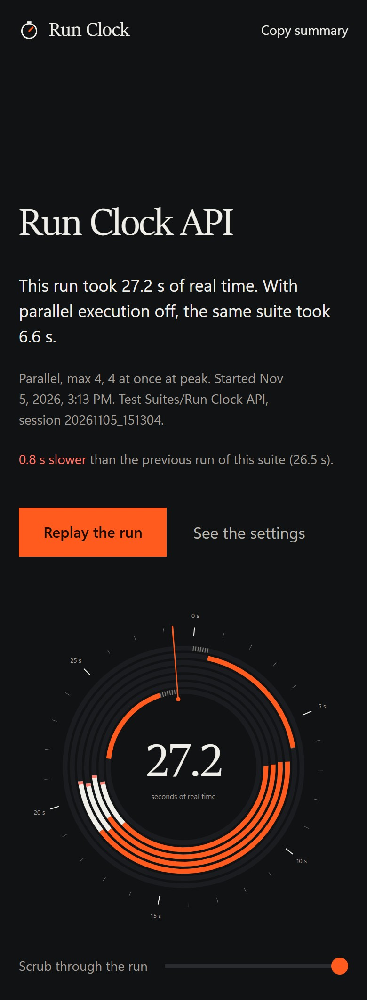
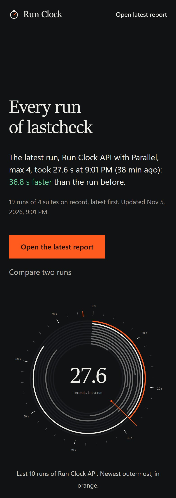

# Katalon Run Clock

Shows how long a Katalon Studio run really took, where the time went, and whether parallel execution makes each test suite faster or slower.



Katalon 11.4+ can run the test cases of a suite in parallel, but each test case gets its own process. For short tests, starting those processes can take longer than the tests themselves, and the run gets slower instead of faster. Test Suite Collection totals in Katalon can also be lower than the time the run actually took. Run Clock measures every process and gives you the real numbers.

## What you get

After every test suite or collection run:

- **Real elapsed time**, from the start of the run to the exit of the last process.
- **Where the time went**: preparing the run, process start-up, the tests themselves, and shutdown.
- **For a single suite**, the measured or estimated time for each setting (parallel off, max 2, 4, 8), and which one is fastest. Each run you make with a different setting replaces an estimate with a measurement.
- **For a Test Suite Collection**, the real start, end and elapsed time of each suite, and whether running its suites one after another or several at once would finish sooner.
- **The tests**: the slowest tests, the tests that took longer than usual, and for a long suite, how to split it evenly across machines.
- **A warning when a run is slower than usual** for its setting, in the report and in the Log Viewer.
- **For CI**: a Markdown summary for the pipeline page, the GitHub Actions job summary, and a one-line message to Slack or another chat tool.
- **An HTML report** (`summary.html`): the run drawn as a chronograph you can replay and scrub through, every setting raced against the others, the suite's recent runs, where the process time went, a timeline of every process with a "processes running" strip, every number as a table, and a copy-summary button. It is a single file with no external resources, so it opens offline and can be attached anywhere.

The summary also appears in the Katalon Log Viewer at the end of each run; for a collection, under its last suite.

## The report

### Which setting is fastest

Every parallel setting of the suite, raced on one clock. For these four short API tests, running them one after another wins: 6.6 s, against 17.3 s at best with parallel execution on.



### Where the time went

In a parallel run, most of the process time can be Java start-up rather than testing. In this run, 84% of it was.



### Collections

The collection's own Execution mode, compared across every way you have run it. All five suites at once took 91.1 s, against 3 min 10 s one after another.



Every Java process of the run, second by second, grouped by suite:



### When a run is slow

When a run takes longer than usual for its setting, the report, the Log Viewer and the chat message say so.



### Every run in one place

`Reports/run-clock/index.html` lists every run in the project. Pick a suite to see its real time run by run, or tick two runs to compare them.





### On a phone

<table>
  <tr>
    <td></td>
    <td></td>
  </tr>
</table>

Every image here is from a real run in Katalon Studio 11.6 on Windows 11. More, from 21 runs of suites, collections, settings and a command-line run: [docs/screenshots](docs/screenshots/README.md).

## In the Log Viewer

Real Log Viewer output for a suite of 4 short API tests, after running each setting at least once (Katalon Studio 11.6, Windows 11):

```
Run Clock | Run Clock API | 20261105_151304
Parallel, Max Concurrent Instances 4, peak 4 at once

Elapsed                  27.2 s   run start to last process exit, without Run Clock itself
Before first process      0.6 s   Katalon preparing the run
Processes                     6   4 with tests, 2 listener-only
Start-up                 11.7 s   median, process start to first listener call
Shutdown                  0.0 s   median, last listener call to process exit
Tests                     9.8 s   4 runs, longest 2.6 s
Run Clock itself          1.1 s   writing this report, left out of every time here

Setting                    Time
Parallel off              6.6 s   measured once
Parallel, max 1          37.0 s   measured once
Parallel, max 2          21.0 s   measured once
Parallel, max 3          65.8 s   measured once
Parallel, max 4          27.2 s   median of 3 runs, this setting
Parallel, max 8          17.3 s   measured once

Fastest: Parallel off (Enable Parallel Execution unticked).
```

## Requirements

- Katalon Studio 11. Tested with 11.6.
- Parallel execution within a suite needs Katalon Studio 11.4+ and an Enterprise licence. Run Clock also measures runs without it.
- Node.js 14+ for the installer only.

## Install

```
npx katalon-run-clock install "C:\path\to\your\katalon-project"
```

Then in Katalon Studio's Tests Explorer, right-click **Keywords** and choose **Refresh**, then do the same for **Test Listeners** and **Include**. Studio does not notice files added from outside until you do. Do the same after an upgrade. No changes to your test cases or suites are needed.

It adds six files:

```
Test Listeners/RunClockListener.groovy
Keywords/runclock/RunClockRecorder.groovy
Keywords/runclock/RunClockReport.groovy
Keywords/runclock/RunClockSettings.groovy
Include/config/runclock/report.html
Include/config/runclock/runclock.properties
```

`runclock.properties` holds your settings. Upgrading keeps your copy; uninstalling leaves it in place.

## Settings

Edit `Include/config/runclock/runclock.properties` in Katalon Studio (Tests Explorer > Include > config > runclock). Each setting can also be set by an environment variable, which wins over the file. That is how a CI pipeline changes a setting without touching the project.

| Setting | Environment variable | Values | Default |
|---|---|---|---|
| `openReport` | `RUN_CLOCK_OPEN` | `studio`, `always`, `never` | `studio` |
| `history` | `RUN_CLOCK_HISTORY` | `on`, `readonly`, `off` | `on` |
| `historyDir` | `RUN_CLOCK_HISTORY_DIR` | a folder, relative to the project or absolute | `Reports/run-clock` |
| `historyLimit` | `RUN_CLOCK_HISTORY_LIMIT` | runs of each suite to remember, 5 to 1000 | `50` |
| `slowerBy` | `RUN_CLOCK_SLOWER_BY` | percent longer than usual that counts as slower | `25` |
| `webhookUrl` | `RUN_CLOCK_WEBHOOK` | a Slack-compatible incoming webhook | empty |
| `ciSummary` | `RUN_CLOCK_CI_SUMMARY` | `on`, `off` | `on` |

A value that is not valid is skipped, and the next one in line is used: the environment variable, then the file, then the default.

## Use

Run any test suite or collection as usual. When a run started from Katalon Studio finishes, its report opens in your browser. Runs from Katalon Runtime Engine and CI servers never open a browser. To change this, set `openReport` in `Include/config/runclock/runclock.properties` to `studio` (default), `always` or `never`, or set the `RUN_CLOCK_OPEN` environment variable.

Every run is also listed in one file:

```
Reports/run-clock/index.html
```

It lists every run in the project, newest first, with the latest run at the top. From there you can:

- open any run's full report,
- filter by suite and see its real time across runs,
- tick two runs and compare them side by side.

Each run's report links back to this page and to the previous run of the same suite. Runs disappear from the list when you delete their folder under `Reports`.

To compare settings for a suite, run it once with each setting you want measured. The setting is under Test Suite > Execution Information > Enable Parallel Execution / Max Concurrent Instances.

## How settings are compared

The same suite with the same setting can take very different times from one run to the next, mostly because process start-up varies. So a setting you have run is shown as the median of its last 5 runs, and the fastest setting is chosen from those medians. One unusually slow or fast run does not change the advice. Run a setting two or three times before acting on a close result.

A setting you have not run yet is estimated: the start-up time measured at the nearest concurrency you have run, plus your test durations spread across the parallel slots. Start-up slows down when many processes start at once, so an estimate for higher concurrency based on a lower one is optimistic. Running a setting once replaces its estimate.

## Keeping runs

Each run's report is the archive. It lives in Katalon's own folder for that run, so it is kept as long as Katalon's report is, and deleting the folder removes the run.

The history is what Run Clock learns from. It is small, and you choose what happens to it with `history`:

| `history` | What happens | Use it for |
|---|---|---|
| `on` (default) | Every run is compared with earlier runs and then added to the history and the All runs page. | Your own machine, and the CI builds of your main branch. |
| `readonly` | Every run is compared with earlier runs, but nothing is written: the history, the run list and the All runs page stay as they were. | Pull-request and feature-branch builds, so they are measured against the main branch without changing it. |
| `off` | No history is read or written. Each report stands alone, with no medians, usual times or links to other runs. | Teams that do not want earlier runs kept. |

The history folder (`historyDir`) holds:

| File | Kept |
|---|---|
| `history.jsonl`: one line per run, used for medians and estimates | The newest `historyLimit` runs of each suite, 5000 in all |
| `tests/`: each test's time per run, one file per suite | The newest 20 runs of each suite |
| `runs.jsonl`: the list behind the All runs page | Runs whose report folder still exists, newest 1000 |
| `index.html`: the All runs page | Rewritten after every run |
| `ci-summary.md`: the latest run's summary | Rewritten after every run |

Each run's report also carries the recent runs of its suite, so a report saved on its own, such as a CI artifact, still shows the trend.

Writes to the history are locked, so suites finishing at the same moment cannot overwrite each other. If the lock cannot be taken within 10 seconds, the run's own report is still written and only the history is skipped; Run Clock never holds up Katalon.

## In a CI pipeline

A CI agent that starts from a clean checkout has no history, so every build looks like the first. Keep the history folder between builds, and use `readonly` for builds that should not change it.

GitHub Actions:

```yaml
- uses: actions/cache@v4
  with:
    path: Reports/run-clock
    key: run-clock-${{ github.ref_name }}-${{ github.run_id }}
    restore-keys: |
      run-clock-${{ github.ref_name }}-
      run-clock-main-
- run: katalonc -noSplash -runMode=console -projectPath="$PWD" -testSuitePath="Test Suites/Smoke" -apiKey="$KATALON_API_KEY"
  env:
    RUN_CLOCK_HISTORY: ${{ github.ref_name == 'main' && 'on' || 'readonly' }}
```

The run's summary is added to the job summary page automatically.

Azure DevOps:

```yaml
variables:
  ${{ if eq(variables['Build.SourceBranchName'], 'main') }}:
    RUN_CLOCK_HISTORY: on
  ${{ else }}:
    RUN_CLOCK_HISTORY: readonly

steps:
- task: Cache@2
  inputs:
    key: 'run-clock | "$(Build.SourceBranchName)" | "$(Build.BuildId)"'
    restoreKeys: |
      run-clock | "$(Build.SourceBranchName)"
      run-clock | "main"
    path: Reports/run-clock
- script: katalonc -noSplash -runMode=console -projectPath="$(Build.SourcesDirectory)" -testSuitePath="Test Suites/Smoke" -apiKey="$(KATALON_API_KEY)"
- script: echo "##vso[task.uploadsummary]$(Build.SourcesDirectory)/Reports/run-clock/ci-summary.md"
  condition: always()
```

Pipeline variables reach Katalon as environment variables, so `RUN_CLOCK_HISTORY` needs no `env:` block. To post to Slack, add your webhook address as a secret pipeline variable named `RUN_CLOCK_WEBHOOK` and map it in the Katalon step with `env: RUN_CLOCK_WEBHOOK: $(RUN_CLOCK_WEBHOOK)`, because Azure does not pass secrets to scripts on its own.

## Test Suite Collections

A collection run gives one report: when each suite started and finished on the collection's clock, a timeline of every process grouped by suite, the slowest tests across all its suites, and the real time of the whole collection. Run Clock knows from the start that a run is a collection, so the first suite to finish is never reported as a run of its own. The suites that finish first only record their times, and the last one writes the report, so a collection pays for one report however many suites it has.

The report also compares the collection's own Execution mode. After a Sequential run it estimates how long 2, 3 or 4 suites at once would take; after a Parallel run it estimates one suite after another. A way you have already run shows the median of its last 5 runs of that collection instead of an estimate. When another way is at least 15% faster, it says which setting to change. Suites on one machine slow each other down, so run a suggested setting once to measure it before you keep it.

The per-suite settings advice comes from running a suite on its own, because suites that share the machine in a collection slow each other down.

## The tests

Every report lists the slowest tests of the run. Once a suite has run three times with history on, each test is also compared with its median over the suite's recent runs, and tests that took longer than usual by `slowerBy` percent (and by at least a second) are listed.

For a suite with at least six tests and a minute of test time, the report also shows how to spread it over 2, 3 or 4 machines: the tests of each part and how long the longest part takes. Each part becomes a suite of its own, for example one per CI agent.

## Slower than usual

When a suite's real time is `slowerBy` percent above the median of its last five runs with the same setting (and at least two seconds above it), the report and the Log Viewer say so, with the median it was compared against. It needs three earlier runs with that setting.

## Large suites

With parallel execution, Katalon starts one process per test case, so a suite of 300 tests is 300 processes. Above 40 processes the dial shows how many processes were starting up, running tests and alive at each moment instead of one ring per process, the timeline uses one thin row per process, and the tables show their first 20 rows with a button for the rest.

## Sharing a report

`summary.html` is one file with no external resources and a content security policy that blocks all network access, so it opens offline and cannot send anything anywhere. It contains your suite and test case names, process IDs and timings, but no file paths from your machine, credentials or test data. Check the names are fine to share before posting a report publicly.

## Uninstall

```
npx katalon-run-clock uninstall "C:\path\to\your\katalon-project"
```

Recorded timings in `Reports/` are kept.

## Limits

- Time Katalon spends generating reports after the last process exits is not included.
- Run Clock writes its report inside the after-suite process, which takes a second or two in a fresh process, once per run. That time is measured, shown as its own phase on the timeline, and left out of the real time and of every comparison, so Run Clock never tilts the advice.
- If a process is killed rather than exiting normally, its shutdown time is not recorded, and a test it was running is shown as incomplete.
- A run stopped before its last suite finishes has no report until the next run in the project finishes, which writes it.
- Estimates are given for single-suite runs, not for collections.
- The report's figures use Sitka, a serif that comes with Windows. Other systems show their own serif.

## Author

Monty Bagati, bagati.monty@gmail.com
